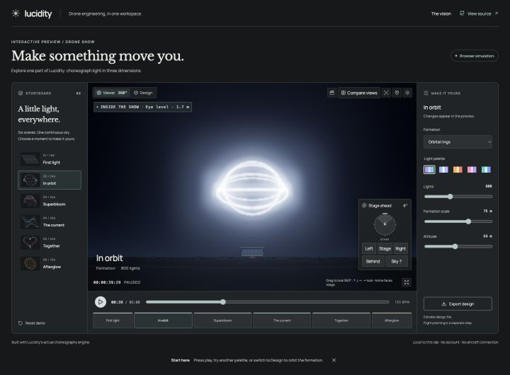

<div align="center">

# Lucidity

### Drone engineering, in one workspace.

Design, configure, program, and understand the aircraft you build.

**[Try the live demo](https://lucidity-drone-studio.greysage256.chatgpt.site)** · [Product vision](drone-studio/docs/PRODUCT_BRIEF.md) · [Studio guide](drone-studio/README.md) · [Run locally](#run-locally)

[](https://lucidity-drone-studio.greysage256.chatgpt.site)

*An interactive slice of Lucidity: choreograph light, change formations, and explore the result in 3D. No account or hardware required.*

</div>

## The vision

Building a drone means working across parts lists, firmware tools, parameter tables, code, and flight logs. The context gets scattered: what changed, which aircraft it changed, and whether it actually worked.

Lucidity brings that work together around the build. The goal is a workspace where **people and AI agents use the same precise, inspectable tools**—from configuring a component to investigating a flight. Every change should connect to its target, its readback, and the evidence it produced.

Drone shows are one application. The bigger idea is a continuous engineering workflow, from the first component to the next experiment.

## What works today

| Workspace | In the prototype |
| --- | --- |
| **Drone Show** | 3D choreography, individual light and motion keyframes, a timeline, audience previews, and editable design exports. |
| **Tools** | Local ArduPilot telemetry, parameter inspection and verified edits, ESC configuration and firmware workflows, and flight-log analysis. |
| **Music & Code** | Motor melody composition, supported ESC startup tunes, a local code editor, and reviewed terminal commands. |
| **Agent tooling** | Shared atomic show-editing commands, a JSON CLI, and a synthetic evaluation harness. |

**In development:** connected build histories, broader hardware support, and deeper agent workflows across the workspace. The app currently has no integrated AI chat. See the [product brief](drone-studio/docs/PRODUCT_BRIEF.md) for the full direction.

This is an early engineering prototype. The public demo runs entirely in the browser; hardware workflows run locally. Show exports are design artifacts, and guarded mission tooling has simulator evidence, not a completed physical Lucidity flight. Read the [mission gate](drone-studio/docs/MISSION_LAUNCH_GATE.md) before aircraft use.

## Run locally

Use **Node.js 24 LTS** and npm.

```sh
git clone https://github.com/maxtano/lucidity.git
cd lucidity/drone-studio
npm ci
npm run dev
```

Open **http://127.0.0.1:5173**. For just the browser demo, run `npm run dev:demo` and open **http://127.0.0.1:5178/demo.html**.

```sh
npm test -- --maxWorkers=2
npm run build
npm run build:demo   # standalone static demo → dist-demo/
```

## Explore the code

- **[drone-studio/](drone-studio/)** — the main React, TypeScript, Three.js and MAVLink workspace.
- **[direction-lab/](direction-lab/)** — a separate simulated-drone experiment with chat, a workbench, and an MCP server.
- **[cad/](cad/)** — experimental printable parts and generators.

[Architecture](drone-studio/docs/TECHNICAL.md) · [Agent tool contract](drone-studio/docs/agent-tools.json) · [Local execution & security](SECURITY.md)

<sub>Third-party firmware and fonts retain their respective licenses and source notices. No repository-wide open-source license has been selected. See [third-party materials](SECURITY.md#third-party-materials).</sub>
