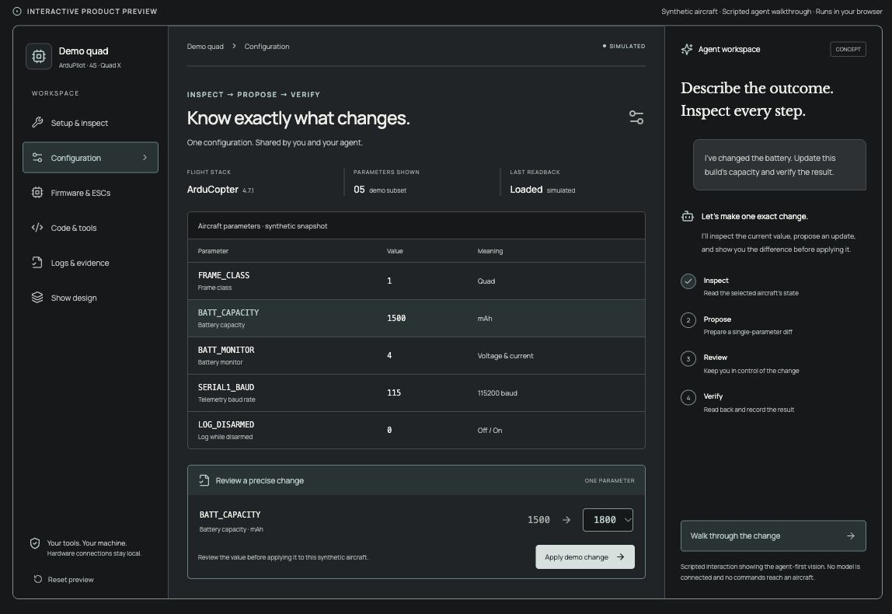

<div align="center">


# Lucidity

### The agent-first workspace for drone engineering.

Set up, configure, and program your drones—with the tools and evidence in one place.

**[Explore the live workspace →](https://maxtano.github.io/lucidity/)** · [Run locally](#run-locally) · [Product vision](drone-studio/docs/PRODUCT_BRIEF.md)

[](https://github.com/maxtano/lucidity/actions/workflows/pages.yml)

[](https://maxtano.github.io/lucidity/)

<sub>Configuration and agent workflow preview · Synthetic aircraft · Scripted agent walkthrough<br/>[View full-size image](docs/media/workspace-preview.jpg) · No account or hardware needed</sub>

</div>

## The vision

Drone engineering spans parts, firmware, parameters, code, and flight logs. Lucidity connects that work around the aircraft: what changed, where it changed, and whether it worked.

The goal is a workspace where **people and AI agents use the same precise, inspectable tools**. Inspect the state, propose a change, review the difference, and verify the result. Drone shows are one application of that broader engineering workflow.

## What works today

| Workspace | In the prototype |
| --- | --- |
| **Tools** | Local ArduPilot telemetry, parameter inspection and verified edits, ESC configuration and firmware workflows, and flight-log analysis. |
| **Music & Code** | Motor melody composition, supported ESC startup tunes, a local code editor, and reviewed terminal commands. |
| **Agent tooling** | Shared atomic show-editing commands, a JSON CLI, and a synthetic evaluation harness. |
| **Drone Show** | 3D choreography, individual light and motion keyframes, a timeline, audience previews, and editable design exports. |

**In development:** connected build histories, broader hardware support, and deeper agent workflows across the workspace. The app currently has no integrated AI chat. See the [product brief](drone-studio/docs/PRODUCT_BRIEF.md) for the full direction.

<details>
<summary>Prototype status and hardware boundaries</summary>

The GitHub Pages preview uses synthetic aircraft data and a scripted agent walkthrough. Hardware workflows run locally. Show exports are design artifacts; guarded mission tooling has simulator evidence, not a completed physical Lucidity flight. Read the [mission gate](drone-studio/docs/MISSION_LAUNCH_GATE.md) before aircraft use.

</details>

## Run locally

Use **Node.js 24 LTS** and npm.

```sh
git clone https://github.com/maxtano/lucidity.git
cd lucidity/drone-studio
npm ci
npm run dev
```

Open **http://127.0.0.1:5173**. For just the browser demo, run `npm run dev:demo` and open **http://127.0.0.1:5178/demo.html**.

```sh
npm test -- --maxWorkers=2
npm run build
npm run build:demo   # standalone static demo → dist-demo/
```

GitHub Pages builds and publishes the static preview from `main` through [this workflow](.github/workflows/pages.yml). No server or API credentials are deployed.

## Explore the code

- **[drone-studio/](drone-studio/)** — the main React, TypeScript, Three.js and MAVLink workspace.
- **[direction-lab/](direction-lab/)** — a separate simulated-drone experiment with chat, a workbench, and an MCP server.
- **[cad/](cad/)** — experimental printable parts and generators.

[Studio guide](drone-studio/README.md) · [Architecture](drone-studio/docs/TECHNICAL.md) · [Agent tool contract](drone-studio/docs/agent-tools.json) · [Local execution & security](SECURITY.md)

<sub>Third-party firmware and fonts retain their respective licenses and source notices. No repository-wide open-source license has been selected. See [third-party materials](SECURITY.md#third-party-materials).</sub>
