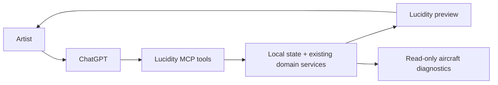

# ChatGPT as the Lucidity interface

**Status: plan, October 22, 2026.** Lucidity's built-in chat assistant is being removed. This document describes a faster way for ChatGPT/Codex to operate Lucidity's existing expert tools. A ChatGPT connection, tunnel, and live-model evaluation are **not implemented or verified** by this plan.

## Why the current interaction feels slow

Lucidity already has local aircraft APIs, an editing command engine, and browser previews. A computer-use agent still has to inspect a page, find controls, click, wait, and inspect again. Screenshots are useful for visual judgment but waste steps when the question is a structured one such as “Which drone is connected?” or “What did the last log show?” The server also cannot reliably answer “Which storyboard and playhead are open?” because those live in React and browser local storage. A generic HTTP or terminal proxy would be fast but would expose too many unrelated and physical-control operations.

## Target experience

The artist chats with ChatGPT. ChatGPT reads the exact current Lucidity state through narrow tools, proposes an edit or diagnosis, and shows a preview and diff in Lucidity. The artist can still use every granular editor control directly. ChatGPT uses browser screenshots only when visual composition or a UI defect actually needs inspection.

## Implementation sequence

1. **Measure and streamline locally.** Record time and tool calls for a fixed set of tasks: read aircraft status, inspect a log, open a storyboard, edit a light cue, and preview the result. While working in local Codex, use Lucidity's structured local APIs for reads and reserve computer-use for visual review. Do not claim a speedup until the same tasks are measured before and after.
2. **Make project state addressable.** Add one compact workspace snapshot with project ID/revision, current scene/selection/playhead, active aircraft identity/link freshness, and long-running job state. The browser's local-storage library must be migrated or synchronized deliberately before an external tool can edit it. Preserve existing authored projects and reject stale revisions. Never infer current UI state from an old chat turn.
3. **Build a small local MCP server over the existing domain layer.** Start with `get_workspace_snapshot`, `list_storyboards`, `inspect_storyboard`, `get_aircraft_status`, `inspect_flight_log`, and `get_job_status`. Return bounded structured data, units, timestamps, and provenance. No generic URL fetcher, JavaScript evaluator, shell command runner, or blanket forwarding of `/api/aircraft/*`.
4. **Add reviewed expert edits.** Expose the existing granular command engine through `prepare_edit` and `commit_edit`. Preparation runs against a clone and returns an exact diff, validation, changed object IDs, sampled preview, and base revision. Commit must match that revision and one prepared transaction; then the UI provides one undo step. Make duplicate retries idempotent and cancellation final. Flight compilation and physical execution remain distinct from creative edits.
5. **Connect ChatGPT privately and evaluate.** OpenAI documents custom MCP servers and a Secure MCP Tunnel that forwards requests to a private local server using an outbound client. Check the account/workspace's custom-server and tunnel availability before relying on that route. The tunnel requires a Platform runtime API key even though Lucidity itself will no longer call an AI provider; keep that key out of the project and logs. Prove one ChatGPT read, one prepared edit, its visible preview, and a reviewed commit with mock aircraft data before considering real-hardware tools. Compare median and 95th-percentile latency and screenshot count with the baseline.

## Hardware boundary

The first ChatGPT bridge is for read-only hardware observation and reversible storyboard design. A model must not gain a generic route to parameter writes, ESC flashing, motor tests, arming, mission launch, or LAND. A later physical-action interface would need separate, server-enforced aircraft identity, fresh telemetry, revision-bound intent, operator review, command acknowledgement, timeout/recovery, and the existing field qualification. Text such as `confirmed: true` supplied by a model is not proof of a physical check.

## Definition of done for the first bridge

- ChatGPT can name the open storyboard/revision and report current aircraft/log state without opening a browser screenshot.
- A request such as “move this cue two seconds later” yields an inspectable before/after preview; a stale or duplicate commit cannot overwrite newer artist work.
- The existing UI and ChatGPT show the same saved result after reload, including undo history where supported.
- Mock-provider/injected-MCP tests cover cancellation, stale revisions, malformed requests, disconnects, oversized data, and untrusted tool content. Real-model quality and physical aircraft behavior are reported separately.
- Measured task latency and screenshot/tool-call counts improve on the recorded baseline.

## References

- [OpenAI: build an MCP server](https://developers.openai.com/plugins/build/mcp-server)
- [OpenAI: add a custom MCP server](https://developers.openai.com/api/docs/guides/custom-mcp-server)
- [OpenAI: Secure MCP Tunnel](https://developers.openai.com/api/docs/guides/secure-mcp-tunnels)
- [Existing Lucidity agent research](AGENT_RESEARCH.md)
