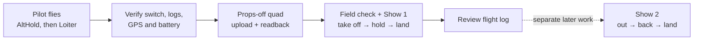

# First live Lucidity shows — one drone

**Status: guarded Lucidity physical Run, monitor and LAND controls are implemented; no Lucidity-launched flight has been tried on this quad.** The pilot-controlled Stabilize hover and props-off motor show worked. **One drone · 1 ft hover** remains a simulation study; its CSV export is not an aircraft mission. The editable **First live hover** storyboard targets 2 m relative to ArduPilot home, which is not guaranteed terrain clearance. Lucidity previews TAKEOFF → LOITER_TIME → LAND, supports props-off disarmed upload/readback, and now performs a short-lived field check before normal non-forced ARM and AUTO mission start. The fixed physical command transaction passed fresh-wipe SITL normal, explicit LAND, suppressed START ACK, link-loss/unknown and two-flight-repeat cases. Mock service/UI checks do not validate the real radio, quad or outdoor flight. See the [SITL evidence](SITL_MISSION_EVALUATION_2026-10-21.md) and [launch gate](MISSION_LAUNCH_GATE.md).

| Step | What counts as a pass |
| --- | --- |
| **1. Pilot checks** | On the actual quad, verify that the top-right Zorro switch selects three distinct, intended modes. With an experienced pilot in a clear outdoor area, fly AltHold and then Loiter separately; verify stable height and position, a practiced switch back to pilot control, sound GPS/compass status, and battery behavior under load. No Lucidity launch here. [ArduPilot says AUTO should follow successful AltHold and Loiter.](https://ardupilot.org/copter/docs/auto-mode.html) |
| **2. Mission transfer — real quad pending** | With every prop removed, Lucidity converts only the vertical one-drone storyboard into inspectable mission items, checks one live disarmed quad, and uploads plus reads back all four stored items. It refuses to overwrite an authored mission. After props are installed at the field, connect/assign/plan/readback remain **read-only**. A real-aircraft transfer has not yet been done. [MAVLink mission protocol](https://mavlink.io/en/services/mission.html) |
| **3. Field readiness — implemented, not field validated** | Lucidity re-downloads and compares the mission, checks fresh ArduCopter 4.7.1 GPS/EKF, battery, receiver/on-ground telemetry and selected RC/battery/arming parameters, then issues a proof valid for at most 15 seconds. The pilot separately confirms actual switch positions, area and prop installation. Copter's normal ARM is still authoritative; a pre-arm-command ACK alone does not prove all checks passed. Lucidity sends no GCS heartbeat, so ground-link loss is **not** verified as automatic LAND. |
| **4. Show 1 — only after 1–3 pass** | In a clear outdoor area with the pilot present, one **Run storyboard** sends mission reset → normal ARM → AUTO start, then monitors flight. **Land** requests LAND mode without an in-air disarm. On unknown result or lost link, do not retry; the pilot uses the tested switch to take control. The exact **1 ft** target remains a simulation study until suitable downward sensing and near-ground behavior are proven. [ArduPilot altitude references](https://ardupilot.org/copter/docs/common-understanding-altitude.html) |
| **5. Show 2** | Only after Show 1's logs and landing are reviewed: take off, hold, move forward, return to the starting area, land. The **5 ft** displacement is a design target, not a positioning guarantee. Validate the actual horizontal accuracy first; ordinary GPS errors can be comparable to or larger than 5 ft. Increase the distance within the pilot-approved clear area or add suitable position sensing if that motion must be precise. [ArduPilot GPS limitations](https://ardupilot.org/copter/docs/common-gps-how-it-works.html) |

The working **preparation** interaction is:

`Your storyboards → First live hover → Flight readiness → Radio setup to check CH5 → Preview → Connect and assign → Verify plan → Props off → Upload and read back`

The implemented **field** interaction, after pilot qualification and the real props-off transfer, is:

`Open storyboard → Connect and assign → Confirm field checks → Check flight readiness (fresh readback) → Run storyboard once → Watch telemetry → Confirm landing and disarm`.

The Zorro remains the pilot's immediate takeover control. The reachable positions of the current three-position CH5 switch must be checked on the actual quad rather than inferred from stored `FLTMODE*` values. RC6 motor stop is an emergency last resort in flight because stopping all motors causes a fall; it is not the normal mission abort or landing method. An interrupted physical run leaves a server journal and blocks another launch until a props-off, freshly disarmed/on-ground recovery check. A successful simulation, mock UI test or bench upload cannot guarantee a safe real flight.
