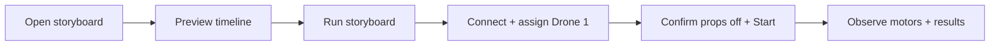

# First drone test · a storyboard

Open **Drone Show → First drone test → Open storyboard**. This creates a saved, editable one-drone show. Your other storyboards stay in the library.



1. **Preview:** press Play on the timeline, or click a motor cue. This only animates the preview.
2. **Edit:** select a scene. Its duration, motor and pulse offset determine the run. Changes save locally. The starter is:

```text
Time     0───3──────9──────15──────21───24s
Motor        A      B       C       D
Pulse        1s     1s      1s      1s    → stop
Power        5%     5%      5%      5%
```

3. **Run storyboard:** review the show name, revision and cue times. Connect the ground radio at 115200 with QGroundControl closed and all propellers removed. Request telemetry, wait for fresh disarmed status and verified firmware, then assign the detected aircraft to **Drone 1**.
4. **Start storyboard run:** confirm the three physical checks. Keep the screen visible and watch each motor pulse stop. **Stop show** cancels remaining cues and requests a motor stop. If a motor continues, disconnect battery power.
5. **Finish:** record what you actually observed, then disconnect the flight battery. Command acknowledgements do not measure motor movement.

**No export or upload is needed to run here.** Export makes a `.lucid.json` copy of the storyboard, including its motor cues. Import restores an editable copy; it does not start motors or upload a flight mission.

This is the storyboard’s **props-off motor channel**, with fixed one-second, 5% pulses. Flight paths are not converted into motor tests. Emergency-stop/failsafe verification and flight remain separate milestones.
