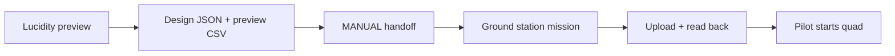

# One drone. Hover for 10 seconds. Land.

**Current first-flight state:** [One-foot hover study](ONE_FOOT_HOVER_STUDY.md). This older page records a separate 3 m concept and is not the next flight procedure.

**Goal:** one drone climbs, hovers at **3 m for 10 seconds**, and lands. No lights, music, or sideways movement. The pilot must approve the provisional height and clear area.

**Studio walkthrough passed:** imported, authored, played, scrubbed, and exported in the app. The downloaded JSON and all 45 CSV samples agree. The user now reports SpeedyBee F405 Mini / ArduCopter 4.7.1; aircraft mission upload and flight remain untested.

The CSV is **not an uploadable aircraft mission**. Manually enter its intent in a compatible ground station; direct Lucidity upload remains unimplemented.

## 1. Check it in the studio

- [ ] **Back up your project:** **Export show → Portable design bundle**. Keep its soundtrack separately; importing replaces the design.
- [ ] Open **Project settings → Open project** and choose [one-drone-flight-rehearsal.lucid.json](../artifacts/one-drone-test/one-drone-flight-rehearsal.lucid.json).
- [ ] In **Design**, select drone 1, **Restart**, then **Play** the **22-second visual rehearsal**. East/North stay zero:

- [ ] Export **Portable design bundle** and **Sampled trajectories**. Check the [rehearsal CSV](../artifacts/one-drone-test/one-drone-flight-rehearsal.preview.csv) against the keys: `(0,0,0) → (0,0,3) → (0,0,3) → (0,0,0)`.

**Pass:** vertical climb, 10-second hold, descent, matching exports. This is a visual illustration, **not a firmware trajectory or flight-dynamics simulation**. Local east/north/up coordinates lack a geographic origin; files contain no autopilot takeoff/landing commands.

The first five-second ramps triggered a speed warning. Six-second ramps reduced sampled peak speed to **0.92 m/s**, below the sample's 1 m/s limit. No failed design checks remain; flight validation is still incomplete.

## 2. Prepare the aircraft — props off

- [ ] Disconnect the battery, remove **every propeller**, then identify the flight controller model/revision and installed firmware/version. Save its existing configuration.
- [ ] Confirm receiver/mode switch, GPS and required heading source, battery monitoring, motor setup, and failsafe configuration. Resolve pre-arm errors; do not disable checks.
- [ ] The mission below requires **supported, commissioned ArduPilot Copter**. Documented SpeedyBee F405 V3/V4 support does not cover every board. Betaflight GPS Rescue does not establish this mission-upload route. Do not flash firmware for this test. [Board support](https://ardupilot.org/copter/docs/common-speedybeef4-v3.html) · [Betaflight GPS](https://betaflight.com/docs/wiki/app/gps-tab)
- [ ] Rehearse in an ArduPilot software simulator. Then back up any existing aircraft mission and enter these items in a compatible ground station:

Do not run AUTO takeoff on the real aircraft during a props-off bench check.

| Sequence | Action |
| --- | --- |
| TAKEOFF | Climb to the pilot-approved height. |
| LOITER_TIME | Hold above the launch location for 10 seconds. |
| LAND | Land at that same clear location. |

Confirm launch coordinates and altitude relative to home. **The autopilot controls actual climb/descent timing**; the illustrated six-second segments are not mission timing requirements. [Command semantics](https://ardupilot.org/copter/docs/mission-command-list.html)

- [ ] With props off and aircraft disarmed, **upload → wait for acceptance → download/read back**. Compare commands, coordinates, altitude frame, height, and duration. Resolve any mismatch before flight; interrupted uploads are not atomic. [Mission protocol](https://mavlink.io/en/services/mission.html)

## 3. Fly — only after the checks pass

- [ ] An experienced pilot first proves manual takeoff/hover/landing and working altitude/position hold in a clear, permitted outdoor area. GPS cannot guarantee an exact landing spot.
- [ ] Remove USB. Confirm home, mission, navigation health, battery, failsafes, and the practiced mode-switch takeover.
- [ ] The pilot explicitly starts the mission, observes climb → hold → land, and confirms disarm before approaching. Unexpected behavior means use the practiced takeover/landing procedure. [AUTO prerequisites and takeover](https://ardupilot.org/copter/docs/auto-mode.html)

**Keep:** hardware/firmware details, configuration backup, verified mission readback, and flight log. Review the result before adding movement.
